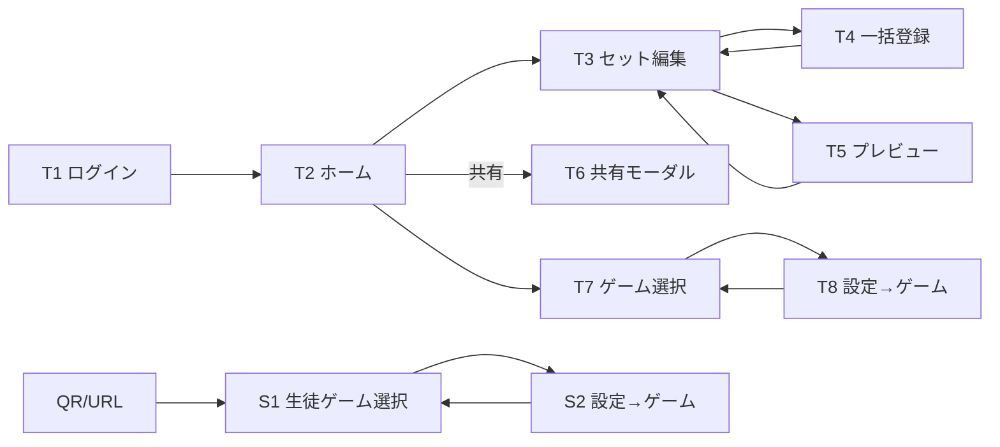

# 英語フラッシュカード＆ミニゲームWebアプリ 開発計画書 v1

作成日: 2026-08-27
対象仕様書: 発注仕様書 v2（2026-08-27確定）
分冊構成: 本書（計画書本体）＋「データ仕様書 v1」（DBスキーマ・JSON・CSV・API定義）

本書は実装担当AIに向けた文書である。実装担当AIは本書とデータ仕様書のみを読んで、環境構築からテスト・公開準備まで進められることを目標に書かれている。仕様書v2の第0章「確定済みの方針」（画像非公開必須／MVP3ゲーム／音声MVP入り／複数教師・生徒はログインなし）は本計画の前提であり、実装中に覆してはならない。

---

## 1. アプリの目的

小・中学校の英語授業で、教師が自作教材（単語・画像・音声）を登録するだけで、フラッシュカード提示と語彙ミニゲームを iPad Safari と教室の大型画面で使えるようにする。教科書改訂時は教材データの差し替えのみで継続利用できる。名称は仮に **WordCards**（実装時の変更可。変更する場合はUI文言とリポジトリ名のみで、コード内部の識別子は `wordcards` のままでよい）。

## 2. 想定利用者

- **教師（登録利用者）**: 同一校・近隣校の英語担当。プログラミング知識なし。管理画面はログイン必須。当面は数名規模を想定し、大規模化はスコープ外。
- **生徒（匿名利用者)**: 小学校低学年〜中学生。ログインなし。共有URL/QRから参加。文字が読めない低学年でも操作できること。
- **利用形態**: (a) 教師端末→大型画面でのクラス全体活動、(b) 生徒iPad（個人・ペア・小グループ）での活動。

## 3. 全体アーキテクチャ

```
┌────────────────────────┐        ┌──────────────────────────────┐
│ フロントエンド (静的SPA) │        │ Supabase (無料枠)              │
│ React+Vite+TS          │ HTTPS  │  Auth: 教師アカウント           │
│ Cloudflare Pages で配信 │───────▶│  Postgres+RLS: セット/カード    │
│                        │        │  Storage(非公開): 画像・音声     │
│ 教師画面 /t/*  (要ログイン)│        │  Edge Functions:               │
│ 生徒画面 /p/:token (匿名) │        │   shared-set(トークン検証+署名URL)│
└────────────────────────┘        │   signup(招待コード検証)         │
                                  └──────────────────────────────┘
```

- フロントは完全に静的配信。秘密情報は持たない（Supabaseの anon key は公開前提の鍵であり、RLSとEdge Functionで保護する。根拠は§14）。
- 画像・音声は**非公開バケット**に置き、**署名付きURL**経由でのみ配信する（仕様書第0章の必須要件）。
- 生徒アクセスは Edge Function `shared-set` が共有トークンを検証してデータと署名付きURLを返す。生徒はDBに直接アクセスしない。

## 4. スコープ

### MVP（本計画のフェーズ1〜6で実装するもの）

- 教師: 招待コード付きサインアップ、ログイン、教材セットCRUD（1件入力・表形式入力・CSV/TSV取込・画像/音声一括アップロード・ファイル名自動マッチング・並べ替え・複製・JSON書き出し/読み込み・ソフトデリート）
- 登録時バリデーション（仕様書§6の検出項目すべて）と画像の自動圧縮
- 共有: 共有URL＋QRコード、トークン再発行、共有の一時停止
- ゲーム3種: フラッシュカード（要復習カード含む）、神経衰弱、Slow Reveal
- 音声: 単語ごとの任意登録、手動再生／表示時自動再生、セット単位＋ゲーム中のオン／オフ
- 小学校モード／中学校モードの表示制御
- アセットの事前読み込み（プリロード）と読込進捗表示

### 第2段階（設計上の布石のみMVPに含める）

- What's Missing?、Hidden Card（リビール基盤を共用）、ジェスチャーゲーム（端末1台方式）
- 短い参加コード（トークンの別名テーブル。データ仕様書§7に布石あり）
- 校内共有（他教師のセットの閲覧・複製。`material_sets` に `school_shared` フラグの布石あり)
- PWA化（ホーム画面追加・オフラインキャッシュ）
- メディアストレージのCloudflare R2移行（転送量が無料枠を超えた場合。§13）
- 生徒側の合言葉（トークンに加えPIN を課すオプション）

### 第3段階（構想のみ）

- ジェスチャーゲーム複数端末同期（Supabase Realtimeで実現可能。チャンネル名=共有トークン）
- 音声一括登録の高度化（発注者保有のmp3資産のフォルダ一括取込）
- 効果音・BGM、教材テンプレート配布

**黙って削らないこと**: 上記の第2段階送りは仕様書v2自身が指定したものであり、それ以外の機能をMVPから外す場合は、実装AIは理由・代替方法・追加時期を成果物のREADMEに明記すること。

## 5. 利用フロー

### 5-1. 教師が教材を作成して共有するまで

1. `/t/login` でログイン（初回は招待コードでサインアップ）
2. ホームで「新しい教材セット」→ セット名・モード（小/中）を入力
3. カード登録（方法は§10。最短は「画像を20枚ドラッグ→ファイル名から単語自動入力→修正」）
4. 表示方法・音声・ゲーム設定を選ぶ
5. プレビューで生徒画面を確認（教師画面内に生徒ビューを埋め込み表示）
6. 保存 →「共有」ボタン → QRコードとURLが表示される
7. QRを大型画面に映す／URLを学習支援ツールで配る → 生徒が参加

### 5-2. 授業中（クラス全体・大型画面）

1. 教師が自分の端末でログイン → セットを開く → ゲーム選択
2. ゲーム設定（1画面で完結、前回設定を記憶）→ 開始
3. フラッシュカード: タップ/矢印キーでテンポよく送る。言えなかったカードは★ボタンで要復習指定
4. 終了画面で要復習カード一覧 →「要復習だけでもう1周」

### 5-3. 授業中（生徒iPad）

1. 生徒がQRを読む → `/p/:token` が開く（ログインなし）
2. 教師が許可したゲームだけが並ぶ選択画面 → タップで開始
3. 開始時にアセットを一括プリロード（進捗バー表示）→ 以降の通信断はゲーム続行に影響しない
4. 終わったら「もういちど」または選択画面へ戻る

## 6. 画面一覧

| # | パス | 画面名 | 利用者 |
|---|------|--------|--------|
| T1 | /t/login | ログイン／サインアップ | 教師 |
| T2 | /t/home | ホーム（セット一覧） | 教師 |
| T3 | /t/sets/:id/edit | セット編集（基本情報・カード一覧） | 教師 |
| T4 | /t/sets/:id/import | 一括登録（表形式・CSV・ファイル一括） | 教師 |
| T5 | /t/sets/:id/preview | プレビュー（生徒ビュー埋め込み） | 教師 |
| T6 | （T2/T3内モーダル） | 共有モーダル（URL・QR・トークン再発行） | 教師 |
| T7 | /t/sets/:id/play | ゲーム選択（教師用） | 教師 |
| T8 | /t/sets/:id/play/:game | ゲーム設定→ゲーム画面 | 教師 |
| S1 | /p/:token | 参加ランディング＝ゲーム選択（生徒用） | 生徒 |
| S2 | /p/:token/:game | ゲーム設定（簡易）→ゲーム画面 | 生徒 |
| C1 | /404 ほか | エラー画面（トークン無効・通信失敗） | 共通 |

ゲーム画面自体は教師用・生徒用で同一コンポーネントを使い、`role`（teacher/student）と設定で機能を出し分ける。ルートは分離し、/t/* はログインガード、/p/* は認証情報を一切持たない。

## 7. 各画面のUIと操作

全画面共通: 日本語UI。最小タップ領域 44×44px、生徒用主要ボタンは 64px 以上。色＋アイコン＋ラベルの併用。破壊的操作は確認ダイアログ。フォントはシステムフォント（-apple-system 系）。

- **T1 ログイン**: メール＋パスワード。タブで「新規登録」（メール・パスワード・招待コード）。パスワード再設定リンク（Supabase Authの標準メールフロー）。
- **T2 ホーム**: セットのカード型一覧（セット名・モードバッジ・カード枚数・更新日・共有中バッジ）。操作: 新規作成／開く／複製／共有／書き出し／削除（ゴミ箱へ）。上部に「ゴミ箱」（30日保持、復元可）。
- **T3 セット編集**: 上部にセット名・モード切替・既定表示方法・音声オンオフ・ゲーム許可設定。下にカード一覧（サムネイル・単語・音声有無アイコン・ドラッグで並べ替え・行タップで編集パネル）。カード追加は「1件追加」「一括登録へ」。未解決エラーがあると保存時に警告パネルで一覧表示（§10-4）。
- **T4 一括登録**: 3タブ。(a) 表形式: スプレッドシート風グリッドに単語を連続入力。(b) CSV/TSV: ファイル選択→プレビュー→取込。(c) ファイル一括: 画像・音声をまとめてドロップ→ファイル名マッチング結果を「自動対応済み／要手動対応」の2列で表示→未対応分は画像タップ→単語選択で対応付け。
- **T5 プレビュー**: 生徒画面S1相当を iframe ではなく同一アプリ内ルートで表示（`preview=1`）。「iPadでの見え方」幅切替（横/縦）。
- **T6 共有モーダル**: 大きなQR（教室の後ろから読める 400px 以上で表示可）、URLコピー、共有オン/オフスイッチ、「URLを作り直す」（旧URL即失効の警告付き）。
- **T7/S1 ゲーム選択**: ゲームごとに大きなカード（アイコン＋名前＋1行説明＋ミニプレビュー画像）。S1では教師が許可したゲームのみ表示。小学校モードのS1は文言を最小化しアイコン主体。
- **T8/S2 ゲーム設定**: 1画面、大きなトグルとステッパーのみ。教師用は全設定、生徒用は教師が「生徒に開放」した項目のみ（既定: 出題順・自動/手動のみ）。「はじめる」で開始。設定は端末の localStorage に記憶（次回既定値）。
- **ゲーム画面共通**: 左上=戻る(確認あり)、右上=設定・音声オンオフ、下部=主要操作。進捗「3/10」表示（非表示可）。正解表示ボタンは教師roleのみ。

## 8. 画面遷移



生徒側 S1/S2 から /t/* への導線は一切置かない（フッターのクレジット等にもリンクを置かない）。ブラウザ「戻る」でゲーム中→S1に戻る際は確認ダイアログを出し、状態破壊を防ぐ（§15）。

## 9. 小学校モードと中学校モードの違い

| 項目 | 小学校モード | 中学校モード |
|------|-------------|-------------|
| 生徒画面の英単語表示 | 既定=非表示。「正解時のみ表示」をセット設定で選択可 | 表示方法5種（単語+画像/単語のみ/画像のみ/表:画像・裏:単語/表:単語・裏:画像）から選択 |
| 音声 | 文字の代替として重視。再生ボタンを大きく配置 | 表示方法と独立にオン/オフ |
| 神経衰弱ペア | 同じ画像同士／関連画像同士（pairImage使用） | 単語×画像／単語同士／画像同士 |
| Slow Reveal | 回答前は文字なし。正解表示=画像全体(+設定で単語+音声) | 正解時に単語+画像+音声 |
| UI文言 | ボタンはアイコン主体・ひらがな最小限 | 通常の日本語UI |
| 管理画面 | 影響なし（教師は常に単語名を確認できる） | 同左 |

モードはセット単位の属性。ゲーム開始時に一時的に切り替えることはできない（迷いを防ぐ）。同じ語彙で両モードを使いたい場合は複製機能で対応する。

## 10. 教材データの入力方法

### 10-1. 登録経路（すべてMVP）

1. **1件入力**: 単語→画像選択（カメラロール/ファイル）→音声選択（任意）。
2. **表形式入力**: グリッドに単語を列挙→あとから画像を一括で対応付け。
3. **CSV/TSV取込**: 列構成はデータ仕様書§5。文字コードはUTF-8（BOM可）とShift_JISを自動判定。取込前にプレビューと行単位のエラー表示。
4. **ファイル一括アップロード＋自動マッチング**: 画像・音声をまとめてドロップ。マッチング規則:
   - ファイル名から拡張子を除き、NFC正規化→小文字化→前後空白除去→全角英数を半角化した文字列を「キー」とする
   - 既存カードの単語を同様に正規化した文字列と**完全一致**なら自動対応
   - 完全一致がなければ、`dog_01` `dog (1)` のような末尾の連番・括弧・区切り記号を除去して再照合
   - それでも未対応のファイルは「要手動対応」列に残す。**曖昧一致（部分一致・類似度）で勝手に対応付けない**
   - カードが存在しない単語のファイルが来た場合は「このファイル名で新規カードを作る」を提案
5. **JSON読み込み**: データ仕様書§4の書き出し形式をそのまま読み込み、新規セットとして復元（画像・音声はJSON内にBase64同梱せず、書き出し時はZIP（JSON+メディア）とする。詳細はデータ仕様書§4）。

### 10-2. アップロード時の自動処理

- 画像: クライアント側で長辺1200pxに縮小し WebP（品質0.8、Safari非対応の後方互換は不要=iPadOS 16以降を対象）へ変換。目標150〜300KB。EXIF回転を適用してから保存。HEICはSafariのcanvasデコードで変換。
- 音声: mp3/m4a を受理、2MB超は拒否。変換はしない（MVP）。
- 元ファイルは保存しない（圧縮後のみ保存。ストレージと転送量の節約。§13）。

### 10-3. 並べ替え・複製・追記

- 並べ替えはドラッグ&ドロップ＋「A→Z」「シャッフルして固定」ボタン。`sort_order` を更新。
- 複製はセット行のメニューから。メディアはStorage上でコピーする（同一ファイル参照にはしない。片方の削除がもう片方を壊すため）。
- 追記はT3の「1件追加」またはT4の一括登録（既存カードとのマッチングは10-1(4)の規則）。

### 10-4. バリデーション（仕様書§6の検出項目との対応）

保存を止める**エラー**: 単語が空のカード／対応していないファイル形式／制限超過ファイル（画像は元10MB超、音声2MB超）。
保存はできるが警告パネルに残る**警告**: 画像未登録カード／単語の重複／同一画像の複数使用／未対応のまま残った画像・音声ファイル／画像のないカードでの「画像のみ」系ゲーム設定。警告が残るセットを共有すると、生徒側ではそのカードを自動スキップし、教師のプレビューに理由を表示する。

## 11. ゲーム仕様詳細（MVP 3ゲーム）

### 11-1. フラッシュカード

**進行**: 設定（表示方法／出題順=順番・ランダム／送り=手動・自動(1〜10秒)／進捗表示／音声）→ カード提示 → 終了画面（要復習一覧＋「要復習だけもう1周」「最初から」「終わる」）。

**操作**: 次へ=右タップ・右スワイプ・→キー・Space。前へ=左タップ・左スワイプ・←キー。表裏反転=カード中央タップ・↑キー（表裏モード時のみ）。要復習トグル=★ボタン・Fキー。音声再生=🔊ボタン・Aキー（自動再生設定時はカード表示時に再生）。連打対策: カード送りは250msのデバウンス。

**要復習カードの再出題アルゴリズム**（仕様書§7-1の必須提示項目）:

- カードは実行中メモリ上で `{cardId, review: boolean, missStreak: number}` を持つ。サーバーには一切保存しない。リロード対策として sessionStorage に現在のゲーム状態のみ保持（タブを閉じれば消える）。
- **方式A: 混在方式**（設定「ふくしゅうを混ぜる」）
  1. 周回（ラップ）開始時に出題列を構築する: 全カード各1枚＋要復習カード各1枚（=要復習は1周に2回出る）
  2. ただし追加枚数は「セット枚数の50%」を上限とし、超える場合は missStreak の大きい順に採用（極端な偏り防止）
  3. シャッフル後、**同一カードの間隔が3枚未満**にならないよう配置する: 列を先頭から走査し、直前3枚に同一カードがあれば後方のランダム位置と交換。10回試行して解消しない場合はそのまま許容
  4. ★解除されたカードは次周から追加分が消える
- **方式B: まとめ方式**（設定「さいごにふくしゅう」）
  1. 1周目: 全カードを設定順で出題。★指定を記録
  2. 2周目: ★カードのみをシャッフルして出題。この周で言えたカードは教師/生徒が★を解除（カード下に大きな「◯ いえた」「★ もういちど」ボタンを表示）
  3. ★が残る限り3周目以降を提案。★ゼロで祝福画面
- 終了画面の要復習一覧は画像サムネイル＋単語（小学校モードの生徒画面では画像のみ）。

### 11-2. 神経衰弱

**設定**: カード枚数（8/12/16/20枚=4/6/8/10ペア）／出題範囲（先頭から順・ランダム抽出）／ペア種別（モード別、§9）／制限時間（なし・1〜10分）／プレイ形式（1人・ペア・チーム対抗2〜4）／正解時音声オン/オフ。

**進行**: 全カード裏向きでグリッド配置（8枚=2×4、12枚=3×4、16枚=4×4、20枚=4×5。縦向きでは列数を減らして再配置）。1手=2枚めくり。一致→表のまま固定し✓マーク＋短いスケールアニメ＋（設定時）音声再生＋チーム得点+1、同チーム続行。不一致→900ms表示後に裏返し、次チームへ。全ペア成立で終了画面（チーム得点、かかった時間）。

**実装上の要点**: 2枚目をめくった瞬間から判定完了まで入力をロック（連打対策）。カードめくりはCSS `transform: rotateY` のみ（レイアウトを動かさない）。「単語×画像」ペアでは、単語カードは文字を大きく（画面幅の1/12以上のフォント）表示。チーム対抗の得点パネルは上部固定、現在の手番チームを枠色＋名前で明示。

### 11-3. Slow Reveal

**設定**: 見せ始め方向（上から/下から/左から/右から/中央から）／段階数（4〜12、既定8）／進行（タップで進む・自動: 1〜10秒間隔）／出題順（順番・ランダム）／正解時の表示（画像全体のみ・画像+単語・画像+単語+音声 ※小学校モードの生徒画面では既定=画像のみ）。

**進行**: 1問=1カード。ステージに画像を `object-fit: contain` で配置（レターボックス。引き伸ばし・切り取りをしない）。カバーが段階的に開く → 生徒が口頭で予想 → 教師（または生徒自身）が「せいかい を みる」ボタン → 正解表示＋音声 → 「つぎへ」。一時停止/再開ボタン、「ぜんぶ見せる」ボタン（教師role常設）。

**リビール基盤（RevealStage）の設計** — Hidden Card（第2段階）と共用するため、次の構造で実装する:

```
RevealStage(props: {
  imageUrl, steps, currentStep, paused,
  method: 'directional' | 'grid' | 'blur' | 'spotlight',
  methodOptions: { direction? , rows?, cols?, openedTiles? }
})
```

- 状態機械はゲーム側が持つ: `{ currentStep, totalSteps, paused, revealedAll }`。RevealStageは純粋な表示コンポーネント。
- `directional`（Slow RevealのMVP実装）: 画像の上にカバー1枚を重ね、`clip-path: inset(…)` を方向と currentStep/totalSteps から算出して適用。`中央から` は `clip-path: circle(r)` の半径を段階拡大。transition 0.4s。GPU合成のみでiPadでも軽い。
- `grid`（Hidden Card用・第2段階）: rows×cols のタイル div を敷き、openedTiles 配列に従い個別にフェードアウト。個別タップ対応。
- `blur` / `spotlight` は第2段階の追加方式（実装しない場合もenumだけ予約）。
- **Slow RevealとHidden Cardの製品上の違い**はゲーム選択画面の説明文で明示する: Slow Reveal=「一方向からだんだん見える」、Hidden Card=「マスを1つずつ開ける」。設定画面・進行UIも別に作り、名前替えの同一ゲームにしない。

### 11-4. 第2段階ゲームの布石（MVPでは実装しない）

- **What's Missing?**: カードグリッド表示→全裏返し→1〜3枚除去→再表示→回答。除去カードの選定は「直近2問で消したカードを除外した中から乱択」で偏りを防ぐ。実装はカードグリッドコンポーネント（神経衰弱と共用）＋タイマーで構成できる。
- **Hidden Card**: RevealStage `grid` 方式。教師の任意タップ開放＋自動乱択開放。
- **ジェスチャーゲーム（端末1台）**: 出題カードを表示する「出題者ビュー」と、得点・残り時間のみの「みんなのビュー」を1端末内で切替。**答えの隠し方**: 「答えを見る」ボタンは `pointerdown` で表示開始・`pointerup`/`pointercancel` で即非表示（長押し中のみ表示）。押下中は画面全体を出題者向け表示に切り替え、離すと0.15秒で全体ビューへ戻す。誤タップ対策に0.3秒以上の押下で初めて表示。スコアはメモリ内のみ。
- 3ゲームとも `games_config` のJSONスキーマ（データ仕様書§3）に設定枠を予約済み。

## 12. 音声機能の仕様

- カードごとに音声ファイル（mp3/m4a、≤2MB）を任意登録。データ構造上は必須にしない。
- 再生制御の階層: セット設定 `audio_enabled`（オフなら全ゲームで音声UI非表示）→ ゲーム設定「じどうで ならす」→ ゲーム中の🔊トグル（いつでも切替）。
- **iPad Safariの自動再生制限への対応**: ユーザー操作起点なしの `audio.play()` は拒否される。対策として、ゲーム開始ボタン（必ずタップされる）のハンドラ内で無音の短いバッファを一度再生して**オーディオをアンロック**し、以後の自動再生を可能にする。Web Audio API（`AudioContext` + `decodeAudioData`）を用い、プリロード済みのArrayBufferから再生する（HTMLAudio要素より遅延が小さく、署名URL失効の影響も受けない）。
- プリロード: ゲーム開始時に画像と同時に音声もfetchしArrayBufferで保持（§15）。
- 音声がないカード: 🔊ボタンをグレー表示（教師role）／非表示（生徒role）。
- 将来の一括登録: ファイル名マッチング（§10-1(4)）は音声にも既に適用されるため、発注者保有のmp3資産はフォルダごとドロップで登録できる。第3段階の「高度化」はZIP取込・話者選択などを指す。

## 13. 技術構成と選定理由

### 13-1. 構成

| 層 | 採用 | 理由 |
|----|------|------|
| フロント | React 18 + Vite + TypeScript + React Router | 実装AIにとって最も情報量が多く堅実。ビルドは静的ファイルのみ |
| 状態管理 | Zustand（ゲーム状態）+ TanStack Query（サーバーデータ） | 小規模で十分・学習コスト低 |
| スタイル | Tailwind CSS | 一貫したサイズ体系（44px系タップ領域）を強制しやすい |
| ホスティング | Cloudflare Pages（無料） | 無料枠が広く商用制限がない。転送量非課金。GitHub連携で自動デプロイ |
| バックエンド | Supabase（無料枠）: Auth / Postgres+RLS / Storage / Edge Functions | 認証・RLS・非公開Storage・署名付きURLが一体で揃い、自前サーバー不要。第0章の非公開要件を最小構成で満たす |
| QR生成 | `qrcode` npmパッケージ（クライアント側生成） | 外部API不使用（教材名等を外部に送らない） |
| CSV解析 | `papaparse` | 実績・Shift_JIS対応（encoding.js併用） |

### 13-2. 比較（仕様書§9の要求）

| 観点 | Supabase（推奨） | Firebase | Cloudflare Pages+Workers+R2+D1 |
|------|----------------|----------|-------------------------------|
| 導入の難しさ | 低: Auth/RLS/Storage/署名URLが標準装備 | 中: Security Rulesの記述が複雑になりがち | 高: 認証を自作する必要 |
| 非公開メディア配信 | ◎ 署名付きURLが標準 | △ ダウンロードトークンは実質無期限で失効管理が弱い | ◎ Worker経由で自由だが自作 |
| 無料枠(2026時点の目安・実装時要確認) | DB 500MB / Storage 1GB / 転送 約5GB/月 | Firestore・Storageに無料枠あり(Storageは要Blazeの場合あり) | R2 10GB・**転送無料** |
| 無料枠超過時 | 停止または課金選択（勝手に課金されない） | Blaze移行で従量課金 | ほぼ超過しない |
| SQL/データ移行性 | ◎ Postgres標準 | △ NoSQL独自 | △ D1(SQLite) |
| 既知の注意点 | **無料プロジェクトは約1週間無操作で一時停止** | ロックイン強め | 組み立てコスト大 |

**推奨: Supabase + Cloudflare Pages。** 理由: 非公開ストレージ＋署名付きURL＋教師認証＋RLSという本案件の核心要件を、サーバー運用知識ゼロ・無料で最短に満たせる唯一の組合せであるため。既知の弱点2つには次で対処する:

1. **一時停止問題**: GitHub Actions の cron（週2回）で `shared-set` 関数にヘルスチェックPingを打ち、停止を防ぐ。実装AIはこのワークフローを必ず含めること。
2. **転送量**: 画像を圧縮済み(≤300KB)で配信し、署名URLの有効期限を7日にして `Cache-Control` を効かせ、リピート授業はブラウザキャッシュで賄う。試算: 20枚セット(画像+音声 約6MB)を30台が初回取得すると約180MB/授業。月5GB枠では**フルクラス個別利用が月25回程度**が上限目安。教師端末+大型画面のみの利用はほぼ消費しない。ダッシュボードの転送量を月1回確認し、超過が近づいたらメディアのみ Cloudflare R2（転送無料）へ移行する（第2段階。Storageパスを抽象化した `mediaStore` モジュール越しにアクセスすることで移行を1モジュール差し替えにする）。

数値の無料枠は変動するため、**実装AIは着手時に各サービスの現行無料枠を確認し、READMEに確認日付きで記録すること。**

### 13-3. 役割分担

- フロントエンド: 全UI、ゲームロジック、画像圧縮、CSV解析、QR生成、プリロード、状態管理
- Postgres: セット・カードのメタデータ（RLSで教師別に隔離）
- Storage: 圧縮済み画像・音声（非公開バケット `media`）
- Edge Function `shared-set`: 共有トークン検証→セットJSON＋署名付きURL一括発行（生徒アクセスの唯一の入口）
- Edge Function `signup`: 招待コード検証つきサインアップ
- GitHub Actions: デプロイ（Pages連携）と keep-alive ping

## 14. 教師用と生徒用の分離・セキュリティ

- **DBアクセス**: RLSで全テーブル「anon拒否・authenticatedは自分の行のみ」（ポリシー全文はデータ仕様書§6）。生徒側は Edge Function（service roleキーはサーバー側のみ）経由でしか読めない。フロントに埋まる anon key では、RLSにより他人・匿名のデータ読取は不可能——これが「公開キーでも安全」の根拠。
- **Storage**: バケットは非公開。教師のアップロードは `authenticated` かつ自分のフォルダ（`{owner_id}/…`）のみ許可。読み取りは署名付きURL（有効期限7日）のみ。恒久直リンクは存在しない。
- **共有トークン**: nanoid 21文字（URLセーフ、約126bit）。`share_enabled=false` で即無効化。「URLを作り直す」で再生成（旧URL失効）。`shared-set` 関数はトークン全体の一致でのみ検索し、部分一致・列挙APIを持たない。簡易レート制限（同一IP 60req/分）を関数内で実装。
- **検索エンジン対策**: 全ページ `<meta name="robots" content="noindex">`、`robots.txt` で全拒否、OGPも置かない。
- **誤操作防止**: 削除は確認ダイアログ→ゴミ箱（`deleted_at` ソフトデリート、30日後にメディアごと物理削除するEdge Function定期実行）→復元可。ゲーム中のブラウザ戻る・リロードは `beforeunload`＋確認ダイアログ。カード編集は自動保存（500msデバウンス）＋保存インジケータ。
- **個人情報**: 収集するのは教師のメールアドレスのみ（認証目的）。生徒の入力欄は一切設けない。得点・要復習はメモリ/sessionStorageのみ。プライバシー方針として `docs/データの取り扱い.md` を作成し、保存先（Supabase、リージョンは東京を選択）と内容を明記する。
- **教材の権利**: 利用規約文書（同md内）に「登録素材の権利は登録した教師に帰属し、システムは授業目的の配信にのみ使用する。教師は自身が利用権限を持つ素材のみ登録する」ことを明記。UI上もアップロード画面に一行注意を常設する。

## 15. iPad Safari対応・通信不安定対応

- 対象環境: iPadOS 16以降のSafari（実装時に学校の実機バージョンを確認。§19）。
- タッチ: `touch-action: manipulation` でダブルタップズーム抑止。ゲーム画面では `user-select: none`。ピンチズームはゲーム画面のみ抑止。
- 画面回転: レイアウトはCSSグリッド＋`dvh`ベースで両向き対応。回転時はゲーム状態(store)を保持したまま再レイアウトのみ行う（stateとviewの分離で保証。回転テストをテスト項目に含む）。
- **プリロード**: ゲーム開始時に `shared-set` 応答内の署名URLから全画像・全音声を `fetch` → Blob/ArrayBuffer化してメモリ保持、画像は `URL.createObjectURL` で表示。効果: (a) ゲーム中の通信断に影響されない、(b) 署名URL失効の影響を受けない、(c) 表示遅延ゼロ。進捗バー「よみこみちゅう… 12/20」を表示し、失敗時は「もういちど」リトライボタン。20枚6MB・校内Wi-Fiで数秒〜十数秒を想定。
- 教師画面のセット一覧サムネイルは遅延読み込み（`loading="lazy"`）。
- PWA/Service Workerキャッシュは第2段階（MVPはプリロード方式で授業中の安定性を確保できるため。追加時は Workbox でアプリシェル＋訪問済みセットをキャッシュ）。
- 低速回線時のUX: すべてのサーバー操作にローディング表示とタイムアウト（15秒）→リトライ導線。オフライン検出（`navigator.onLine`）でバナー表示。

## 16. 開発手順（フェーズ分割）と受け入れ条件

実装は以下の順で行い、各フェーズの受け入れ条件を満たしてから次へ進む。各フェーズ完了時に動作するデプロイが存在すること（トランクベース、main=本番）。

### P0 環境構築
リポジトリ作成、Vite+React+TS+Tailwind雛形、Cloudflare Pages連携、Supabaseプロジェクト作成（東京リージョン）、マイグレーション基盤（supabase CLI）、CI（型チェック+lint+ビルド）、keep-alive Actions。
**受け入れ**: mainへのpushで本番URLが更新される。空アプリがiPad Safariで表示される。`supabase db push` でスキーマが適用できる。

### P1 認証と教材管理
signup関数（招待コード）、ログイン/ログアウト、T2ホーム、T3セット編集（1件入力・編集・並べ替え・複製・ソフトデリート/復元）、画像圧縮アップロード、音声アップロード、バリデーション（§10-4）。
**受け入れ**: 招待コードなしで登録できない。教師Aが教師Bのセットを一切読み書きできない(APIレベルで確認)。10MBのJPEGが300KB程度のWebPになって保存される。EXIF回転が正しく適用される。削除→ゴミ箱→復元が動く。全バリデーション項目が仕様どおりエラー/警告に振り分けられる。

### P2 一括登録と入出力
T4（表形式・CSV/TSV・ファイル一括＋自動マッチング）、JSON/ZIP書き出し・読み込み。
**受け入れ**: データ仕様書§5のサンプルCSVが取り込める。Shift_JIS CSVが文字化けしない。`dog.jpg, cat.jpg, dog2.jpg` を単語 `dog, cat` のセットに投げると dog/cat が自動対応し dog2 が要手動対応に残る。書き出したZIPを読み込むと画像・音声込みで同一セットが復元される。

### P3 共有と生徒アクセス
share_token発行、T6共有モーダル（QR含む）、`shared-set` 関数、S1ランディング、プリロード基盤、noindex一式。
**受け入れ**: 教師のiPadで作ったセットが、**別のiPad（ログインなし）**でQRから開ける。共有オフにすると同URLが404になる。トークン再発行で旧URLが失効する。生徒画面から管理画面へ遷移する導線が存在しない。画像へ署名なしURLでアクセスすると403になる。

### P4 フラッシュカード
T7/T8/S2、フラッシュカード本体、要復習（方式A/B）、音声再生（アンロック含む）、小中モード表示制御。
**受け入れ**: §11-1の全設定が機能する。方式Aで同一カードが3枚以内に連続しない。方式Bで★ゼロまで周回できる。自動再生設定でカード表示時に音が鳴る（初回タップ後）。小学校モードの生徒画面に英単語が表示されない。連打してもカードが飛ばない。

### P5 神経衰弱とSlow Reveal
両ゲーム本体、RevealStage（directional）、ゲーム選択画面の説明文・プレビュー。
**受け入れ**: §11-2/11-3の全設定が機能する。神経衰弱で判定中の追加タップが無効。20枚でも60fps相当でめくれる（iPad実機）。Slow Revealで縦長・横長画像が歪まない。中央からモードが円形に開く。ゲーム選択画面で3ゲームの違いが説明されている。

### P6 仕上げ・QA
エラー画面、オフラインバナー、プレビューT5、`docs/`一式（導入手順・運用手順・データの取り扱い）、§18テストの全消化、実機テスト。
**受け入れ**: §18のテスト項目がすべてPass。docs だけ読んで発注者が新環境に導入できる。

### 第2段階（本計画の範囲外・順序のみ指定）
What's Missing → Hidden Card → ジェスチャー(1端末) → 参加コード → 校内共有 → PWA → （必要時）R2移行 → 合言葉

## 17. 想定される問題点と対策

| 問題 | 対策 |
|------|------|
| Supabase無料プロジェクトの自動一時停止 | keep-alive ping（P0で必須実装）。それでも停止した場合はダッシュボードから手動再開（運用手順書に記載） |
| 転送量が無料枠を超える | §13-2の試算と月次確認。超過前にR2移行（mediaStore差し替え） |
| 学校のフィルタリングでドメインが弾かれる | §19の事前確認。ブロック時は学校のネットワーク管理者に「アプリドメイン＋*.supabase.co」の許可申請（依頼文テンプレを運用手順書に含める） |
| 授業中のWi-Fi断 | プリロード方式によりゲーム続行可。参加時に断→リトライボタン |
| 署名URLが授業中に失効 | 有効期限7日＋Blob保持のため実質発生しない |
| Safariの音声自動再生ブロック | 開始ボタンでのアンロック（§12）。テスト項目に含む |
| iPadからのHEIC画像 | canvas経由でWebP変換（Safariはネイティブデコード可） |
| 生徒の誤操作（連打・戻る・回転） | デバウンス・確認ダイアログ・state/view分離（§15） |
| 共有URLの外部流出 | 影響範囲は当該セットの閲覧のみ。トークン再発行で即失効。運用手順書に手順記載 |
| 教師のパスワード忘れ | Supabase Auth標準のリセットメール |
| 招待コードの漏洩 | 環境変数で変更可能。漏洩時は変更（既存アカウントには影響なし） |
| 無料枠仕様の将来変更 | README に確認日付きで枠を記録し、運用手順書に月次確認を組み込む |

## 18. 動作確認・テスト項目

自動テスト（Vitest）: 要復習アルゴリズム（間隔制約・上限・★解除）／ファイル名マッチング正規化／CSV解析（UTF-8・BOM・Shift_JIS・不正行）／神経衰弱の判定ロジック／RevealStageのclip-path算出。CIで実行。

手動テスト（iPad実機・チェックリスト化して `docs/テスト項目.md` に含める）:

1. 認証: 招待コード誤り→拒否／正→登録。リセットメール受信。
2. 分離: 教師Bで教師AのセットID直打ち→403。生徒URLから /t/ 直打ち→ログイン画面。
3. 教材: 各登録経路、全バリデーション、複製、ZIP往復、ゴミ箱復元。
4. 共有: 別端末QR参加、共有オフ→404、再発行→旧URL失効、画像直URL→403。
5. 各ゲーム: 全設定の組合せ代表ケース、進捗表示/非表示、音声オンオフ・自動再生、正解表示。
6. iPad: 縦横回転中のゲーム継続、連打、スワイプ誤反応、ダブルタップズームが起きない、機内モードでゲーム続行、復帰後の参加、44/64pxタップ領域。
7. 大型画面: 教師iPad→HDMI/AirPlayミラーリングで文字・カードが教室後方から視認できる（フォントサイズ実測）。
8. 性能: 20枚セットのプリロード時間、神経衰弱20枚のアニメーション、低速回線シミュレート（Safari開発メニュー）。
9. セキュリティ: noindex確認、`shared-set` レート制限、anon keyでのテーブル直接クエリが空を返すこと。

## 19. 開発前に発注者が学校で確認する前提条件

実装と並行してよいが、**P3完了までに**確認すること。結果は実装AIに伝える。

1. 生徒用iPadのiPadOSバージョン（設定→一般→情報）。16未満の端末が現役なら対象バージョンを引き下げ、WebP変換をJPEGに変更する（実装への影響はこの1点に局所化してある）。
2. 生徒用iPadでQRカメラ→Safari遷移が制限されていないか（任意のQRで試す）。
3. フィルタリング: 生徒用iPadで (a) `*.pages.dev`（または取得する独自ドメイン）、(b) `*.supabase.co` が開けるか。ブロック時は§17の許可申請。
4. 校内Wi-Fi帯域: 生徒30台で同時に同一Webページ（画像数MB）を開く実験。極端に遅い場合は「教師が授業前に生徒iPadで参加→プリロードまで済ませておく」運用（運用手順書に記載）で回避可能。

## 20. 実装AIが作成すべきファイル構成

```
wordcards/
├─ index.html
├─ package.json / tsconfig.json / vite.config.ts / tailwind.config.js
├─ public/            # robots.txt(全拒否), favicon
├─ src/
│  ├─ main.tsx  App.tsx  routes.tsx
│  ├─ lib/
│  │  ├─ supabase.ts        # クライアント初期化
│  │  ├─ mediaStore.ts      # Storage抽象層(R2移行点)
│  │  ├─ imageCompress.ts   # 縮小/WebP/EXIF/HEIC
│  │  ├─ audio.ts           # アンロック/WebAudio再生
│  │  ├─ preload.ts         # 一括fetch→Blob/ArrayBuffer
│  │  ├─ csv.ts  matching.ts  exportZip.ts  qr.ts  validation.ts
│  ├─ stores/               # zustand: gameSession, editor
│  ├─ api/                  # TanStack Query hooks (sets, cards, share)
│  ├─ components/
│  │  ├─ ui/                # Button, Dialog, Stepper, Toggle, ProgressBar
│  │  ├─ RevealStage.tsx  CardGrid.tsx  QrPanel.tsx  AudioButton.tsx
│  ├─ pages/
│  │  ├─ teacher/  Login  Home  SetEdit  SetImport  Preview  PlaySelect
│  │  ├─ student/  Landing  StudentPlay
│  ├─ games/
│  │  ├─ shared/            # 進捗表示, 設定パネル枠, 終了画面枠, 型
│  │  ├─ flashcards/        # index.tsx, settings.ts, reviewQueue.ts
│  │  ├─ memory/            # index.tsx, settings.ts, logic.ts
│  │  ├─ slowreveal/        # index.tsx, settings.ts
│  ├─ styles/
├─ supabase/
│  ├─ migrations/           # データ仕様書§2のスキーマ+§6のRLS
│  ├─ functions/shared-set/  functions/signup/  functions/purge-trash/
├─ .github/workflows/       # ci.yml, keepalive.yml
├─ docs/
│  ├─ 導入手順.md  運用手順.md  テスト項目.md  データの取り扱い.md
│  └─ (本計画書・データ仕様書のコピー)
```

## 21. 導入・公開・更新方法

- **初回導入**（実装AIが `docs/導入手順.md` に非エンジニア向け手順として清書する）: GitHubリポジトリ作成 → Supabaseプロジェクト作成（東京・無料）→ `supabase db push` でスキーマ適用 → Edge Functionsデプロイ → 環境変数（SUPABASE_URL / ANON_KEY / 招待コード / サービスロールキーは関数側のみ）→ Cloudflare Pages をリポジトリに接続 → 動作確認チェックリスト。
- **更新**: mainへpushで自動デプロイ。スキーマ変更はマイグレーションファイル追加→`db push`。発注者の運用は「Claude/Codexに修正させ→GitHubへ反映」で完結し、ローカル開発環境を必須としない。
- **独自ドメイン**は任意（年1,000円強）。使わない場合は `*.pages.dev` のまま運用可。

## 22. 学校での運用方法

- **教師の追加**: 招待コードを口頭で伝える→各自サインアップ。運用手順書に3行の案内文テンプレを用意。
- **授業前チェックリスト**（運用手順書に含める）: 前日=プレビューで全カード確認・警告ゼロ確認／当日=共有オン確認・（帯域が細い校では）生徒iPadで事前プリロード。
- **教材権利ルール**: 登録できるのは自作・フリー素材・勤務校で利用権限のある教科書由来素材のみ。共有URLは校外に転載しない。年度末にトークン再発行を推奨。
- **月次メンテ**（5分）: Supabaseダッシュボードで転送量・容量確認、ゴミ箱の中身確認。
- **問い合わせ窓口**: 発注者（管理者役）。パスワードリセットはメールで自己完結。

## 23. 将来的に追加できる機能（第2・第3段階の再掲を除く）

音声の自動生成（TTS）連携／教材セットの学校間共有・テンプレート配布／簡単なワークシート出力（カード一覧のPDF化）／Slow Reveal等の出題履歴に基づく「今日よく間違えた単語」の授業末サマリー（個人に紐づけない集計のみ）／英語以外の教科への転用（データ構造は言語非依存）。

---

## 実装AIへの最終指示

1. まずデータ仕様書 v1 を読み、スキーマとAPIを先に固定すること（P0でマイグレーションまで作る）。
2. フェーズ順（P0→P6）を守り、各受け入れ条件を満たしてから進むこと。受け入れ条件はそのままE2Eの手動確認項目として `docs/テスト項目.md` に転記すること。
3. 確定方針（画像非公開・MVP3ゲーム・音声オンオフ・複数教師/生徒匿名）に反する「簡略化」をしないこと。特に、共有機能を localStorage 保存で代替する実装は仕様違反である。
4. 無料枠・SDK仕様は着手時に現行ドキュメントで確認し、相違があれば本計画の該当箇所を修正してREADMEに差分を記録すること。
